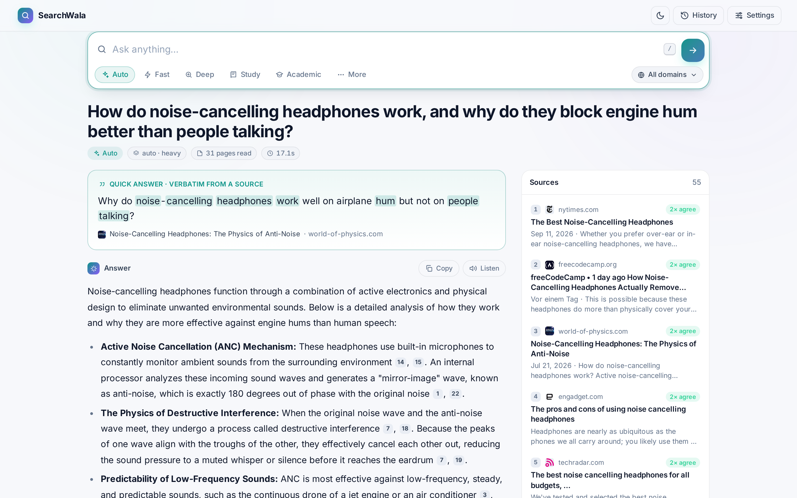
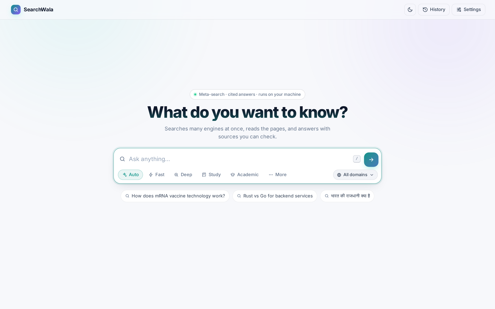
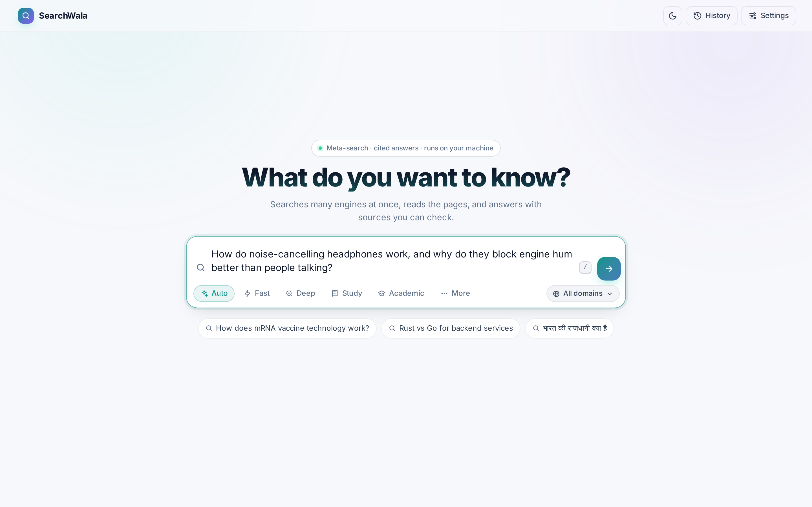
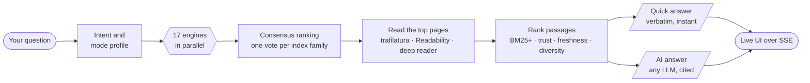

<div align="center">

# ⚡ SearchWala

### A private meta-search and answer engine, in one Rust binary

Ask a question. SearchWala searches 17 engines at once, reads the pages they
agree on, and answers with citations you can click, using any LLM or none.

[](https://github.com/SandeepAi369/SearchWala/actions/workflows/ci.yml)
[](https://github.com/SandeepAi369/SearchWala/actions/workflows/codeql.yml)
[](https://github.com/SandeepAi369/SearchWala/actions/workflows/security-audit.yml)
[](https://scorecard.dev/viewer/?uri=github.com/SandeepAi369/SearchWala)
[](.github/dependabot.yml)

[](https://github.com/SandeepAi369/SearchWala/releases/latest)
[](https://www.rust-lang.org/)
[](#development)
[](./LICENSE)
[](https://github.com/SandeepAi369)
[](https://github.com/SandeepAi369/SearchWala/stargazers)



</div>

---

## Why SearchWala

- **Consensus, not one index.** Pages rank by how many *independent* search
  indexes agree on them. Seven Bing-derived engines count as one vote.
- **It reads the pages.** Full text is extracted (trafilatura + Readability +
  a deep reader for Next.js, Shadow DOM and paywall-teaser pages), not just
  snippets.
- **Answers you can check.** Every `[n]` links to the exact source the model
  saw, and each citation is checked against the cited text.
- **Works without an LLM.** You still get ranked sources and a quick answer
  quoted word for word from them.
- **Your chats, saved on your machine.** Every conversation is kept locally
  and reopens exactly as it was. Follow-ups can remember the last 10 answers
  (or any number, or none). Search engines never see your history.
- **Listen to any answer.** A natural neural voice reads answers aloud, in
  Hindi or English.
- **Private by default.** One binary on `127.0.0.1`. No account, no telemetry,
  and search needs no API key. Your LLM key stays in your browser.

## See it in action

<table>
  <tr>
    <td width="33%"></td>
    <td width="33%"></td>
    <td width="33%"></td>
  </tr>
  <tr>
    <td align="center"><b>1. Pick a mode</b><br><sub>Auto, Fast, Deep, Study, Academic</sub></td>
    <td align="center"><b>2. Ask anything</b><br><sub>the box grows with your question</sub></td>
    <td align="center"><b>3. Get a cited answer</b><br><sub>sources ranked by agreement</sub></td>
  </tr>
</table>

## How it works



Results stream to the browser as they arrive. Sources and the quick answer
show up before the AI answer is finished.

## Chats, memory and voice

**Everything stays on your machine.** Chats live in one local SQLite file,
`~/.searchwala/searchwala.db`. Nothing is uploaded, and no account is
needed.

- **A sidebar like your favourite AI chat app.** It has New chat, search, and
  chats grouped by date. Reopening a chat shows every question, answer, source
  and citation as it was, without searching again.
- **Nothing gets lost.** The question is saved the moment you ask it. If you
  close the tab mid-search, the server finishes and saves the answer, and a
  refresh brings you back to the same chat.
- **You decide what the AI remembers** (Settings → Conversations):
  - **Memory 10 (default):** follow-ups like *"when was he born?"* understand
    the earlier answers in that chat.
  - **Any number:** raise it to suit your model's context window.
  - **Off:** each question is answered on its own; chats are still saved for
    you to read.
- **Memory can't leak or mislead.** Search engines get a rewritten standalone
  query, never your history, and the AI must cite this turn's sources rather
  than its own earlier answers.
- **Delete anytime:** one chat, or all of them. Deleted chats are overwritten
  on disk. Only the SearchWala page can read your chats; other websites
  can't.
- **Scripts stay stateless.** API calls are not saved unless the request sets
  `"save": true`.

**🔊 Listen.** Press **Listen** on any answer, including earlier ones in a
chat, and a neural voice reads it aloud. Hindi answers get a Hindi voice. If
the online voice is unavailable, your browser's built-in voice takes over, so
Listen never fails silently. The neural voice uses
[edge-tts](https://pypi.org/project/edge-tts/): `pip install edge-tts`.

## The five modes

| Mode | Best for | Engines | Pages read | Search time* |
|---|---|---|---|---|
| ⚡ **Fast** | quick facts; stops once 3 independent indexes agree | 5 | ~10 | 2–4 s |
| 🤖 **Auto** | everyday questions; sizes itself to the question | 5–17 | 8–55 | 2–6 s |
| 🔬 **Deep Research** | reports; sub-queries plus a map-reduce write-up | 17–18 | ~150 | 15–25 s |
| 📘 **Study** | learning; educational sources, study notes and a self-test | 6 | ~35 | ~6 s |
| 🎓 **Academic** | literature reviews from OpenAlex and arXiv | 6 | ~40 | 4–6 s |

\* Search and reading only, on a home connection; the LLM's time comes on top.
Reddit and YouTube modes and five domains (`tech`, `science`, `finance`,
`health`, `news`) combine with any mode.

Measured on 20 hand-labelled queries against live engines, Deep reaches
**nDCG@10 0.524** and **MRR 0.744**.

## Quick start

```bash
git clone https://github.com/SandeepAi369/SearchWala && cd SearchWala
cargo build --release
./target/release/searchwala        # open http://127.0.0.1:8000
```

Or download the prebuilt Linux binary from
[Releases](https://github.com/SandeepAi369/SearchWala/releases/latest), or use
Docker:

```bash
docker build -t searchwala .
docker run -p 7860:7860 -v searchwala-data:/home/searchwala/.searchwala searchwala
```

The `-v` volume keeps your saved chats when the container is replaced.

**Add an AI model (optional):** Settings → choose a provider → paste a key →
pick a model. Supported: OpenAI, Anthropic, Gemini, Groq, Cerebras, DeepSeek,
xAI, OpenRouter, Together, Fireworks, SambaNova, NVIDIA NIM, **Ollama** (local,
no key) and any OpenAI-compatible server.

**Use it from code:**

```bash
curl -X POST localhost:8000/search -H 'Content-Type: application/json' \
  -d '{"query":"how does mRNA vaccine technology work","focus_mode":"study"}'
```

## Security

SearchWala relays your LLM key and fetches URLs from search results, so both
directions are guarded:

- **Localhost only** by default (`127.0.0.1`).
- **No SSRF.** Page fetches can't reach private, loopback, link-local or
  cloud-metadata addresses. DNS rebinding is blocked and every redirect hop
  is re-checked.
- **Keys stay yours.** They're stored only in your browser, never logged, and
  redacted from provider errors. They're never re-routed to another provider.
- **Your chats stay on your machine.** Every conversation is saved to a local
  SQLite file and can be deleted one by one or all at once. Only the
  SearchWala page itself can read them, not other websites.

The repository is guarded the same way: CodeQL, a daily RustSec audit,
Dependabot, OpenSSF Scorecard, SHA-pinned Actions and a protected `main`
branch. To report a vulnerability, see [SECURITY.md](SECURITY.md).

## Documentation

- **[Full reference](docs/REFERENCE.md):** all 17 engines, the stealth TLS
  layer, extraction benchmarks, ranking, every API endpoint and every setting
- **[Engineering log](docs/IMPLEMENTATION_BLUEPRINT.md):** the v7 → v8.1
  rebuild, bug by bug

## Development

```bash
cargo test --release                          # 307 unit tests
cargo run --release --bin intent_probe        # intent accuracy: 50/50
cargo run --release --bin eval -- --limit 20 --focus fast   # retrieval quality
cargo run --release --bin highlight_probe     # quick answers on 45 saved real queries
```

Parser tests run against real search-results HTML in `tests/fixtures/`, so a
selector that stops matching fails CI instead of silently returning nothing.
CI builds with `-D warnings`.

## License

Apache-2.0 © 2026 [SandeepCH](https://github.com/SandeepAi369). See [LICENSE](./LICENSE).

<div align="center"><sub>If SearchWala is useful to you, a ⭐ helps other people find it.</sub></div>
